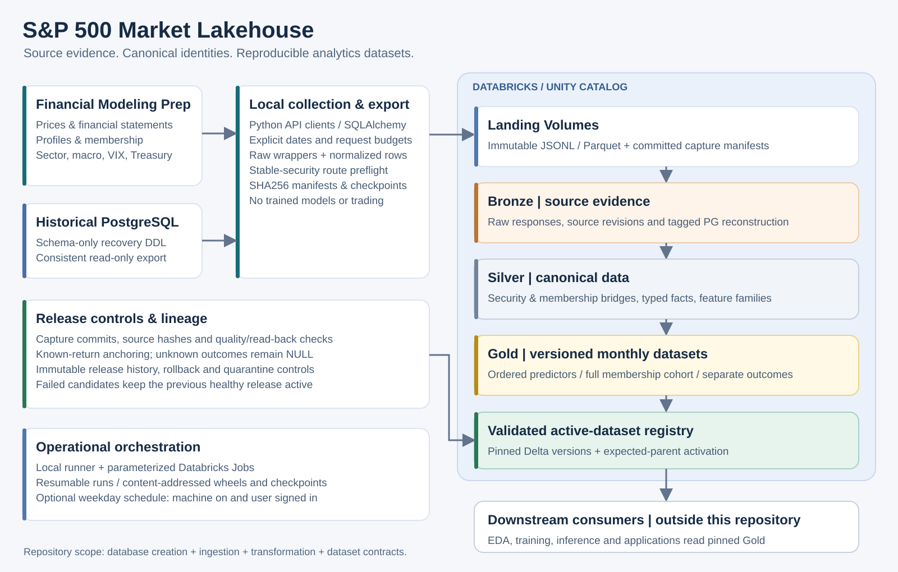

# S&P 500 Market Lakehouse

**A governed market-data foundation built with Databricks, Delta Lake and Unity Catalog.**

This project ingests Financial Modeling Prep (FMP) market data, migrates a historical PostgreSQL database, and builds versioned, analytics-ready datasets through Landing, Bronze, Silver and Gold layers. It preserves raw evidence, resolves stable security identities, separates predictors from outcomes, and publishes validated releases through an atomic active-dataset registry.

This repository contains **database creation, ingestion, transformation and data-architecture code**. Vendor datasets, credentials, trained models, trading logic and research results are excluded.

## Architecture



[Detailed architecture and Mermaid source](docs/architecture.md) · [Data contracts](docs/data_contracts.md) · [Operations guide](docs/operations.md) · [Skills demonstrated](docs/skills-demonstrated.md)

## What it does

- **Collects market data:** stock and ETF prices, financial statements, market capitalization, enterprise value, profiles, index membership, macro instruments, VIX and Treasury rates.
- **Preserves source evidence:** unchanged API response wrappers and normalized observations are written separately, with request metadata, capture clocks, content hashes and resumable checkpoints.
- **Migrates PostgreSQL history:** read-only, repeatable-read exports preserve a consistent baseline; schema-only SQL recreates the legacy database structure without publishing its rows.
- **Builds canonical data:** stable-security routes, historical membership, typed financial observations, adjusted prices and feature families are materialized in Delta.
- **Publishes reproducible datasets:** monthly predictors, full membership and forward outcomes are stored separately, pinned to Delta versions and selected through a guarded release registry.
- **Checks data before activation:** file hashes, keys, duplicate revisions, NULL patterns, date coverage, predictor contracts and known-return consistency must pass. Failed candidates leave the prior active release in place.

The reference migration covered **51 PostgreSQL tables and 26.9 million rows**, producing a historical Gold panel spanning **106 monthly signals with 215 declared predictors**. These are engineering-validation statistics from the original deployment; no underlying records or access to that deployment are included.

## Skills demonstrated

| Area | Applied skills |
| --- | --- |
| Data engineering | REST ingestion, JSON Lines, historical backfills, incremental capture, ETL/ELT, idempotency and quota-aware retries |
| Lakehouse engineering | Databricks Jobs, Unity Catalog, Volumes, Delta Lake, Medallion Architecture and version-pinned releases |
| Database engineering | PostgreSQL DDL, schema inventory, repeatable-read snapshots, bulk Parquet export, business-key contracts and migration reconciliation |
| Programming | Python, SQL, PySpark, Spark SQL, pandas, NumPy, PyArrow and reusable package design |
| Financial data modeling | Stable security identity, effective-dated routes, historical membership, adjusted prices, statement availability and market calendars |
| Data quality and lineage | SHA256 manifests, revision preservation, NULL semantics, source-to-target mapping, synthetic formula parity and read-back checks |
| Operations | Environment-based configuration, resumable checkpoints, local-to-cloud orchestration, guarded activation, rollback quarantine and CI |

See [Skills demonstrated](docs/skills-demonstrated.md) for the implementation evidence and engineering lessons.

## Tech stack

| Area | Tools |
| --- | --- |
| Languages | Python, SQL |
| Source APIs | Financial Modeling Prep |
| Legacy database | PostgreSQL, SQLAlchemy, psycopg2 |
| Local processing | pandas, NumPy, PyArrow, python-dotenv, requests |
| Lakehouse | Databricks, PySpark, Spark SQL, Delta Lake |
| Governance | Unity Catalog, Volumes, immutable manifests and active-release registry |
| Storage formats | JSONL, Parquet, Delta |
| Orchestration | Databricks Jobs, Python CLI, optional Windows Task Scheduler |
| Validation | unittest, synthetic fixtures, reconciliation checks, GitHub Actions |

## Data layers

| Layer | Purpose | Representative assets |
| --- | --- | --- |
| Landing | Immutable response wrappers and normalized envelopes | Capture manifests, date-partitioned JSONL and SHA256 receipts |
| Bronze | Retain raw observations and tagged historical reconstruction | FMP source records; `pg_*` baseline tables |
| Silver | Canonical identities, typed observations and computed feature families | Security dimension, membership bridges, adjusted prices, financial observations, technical/financial/sector/macro features |
| Gold | Reproducible monthly consumption contracts | Separate feature, membership-cohort and target tables pinned to Delta versions |
| Operations | Commit, validation and release authority | Capture commits, factor audits, release history, active binding and quarantine registry |

Unused legacy tables remain explicitly classified as historical archives. They are not presented as continuously refreshed feeds.

## Repository structure

```text
ingestion/src/sp500_ingest/       # API clients, identity, landing, PostgreSQL exports
lakehouse/src/sp500_lakehouse/   # Delta layers, transforms, features, targets, releases
scripts/                        # collection, backfills, migration and orchestration
notebooks/                      # Databricks setup, ingestion, Silver, Gold, validation
sql/postgres/                   # schema-only legacy database creation
config/                         # source mapping, table/feature contracts, example settings
jobs/                           # parameterized Databricks Job definitions
tests/                          # synthetic tests and frozen pure reference functions
docs/                           # architecture, operations, contracts and engineering skills
.github/workflows/              # offline unit tests and packaging validation
.env.example                    # configuration keys without credentials
databricks.yml                  # Free Edition/serverless and classic bundle targets
```

## Quick start

Use Python 3.10 or later. From a fresh clone:

```bash
python -m venv .venv
# macOS/Linux: source .venv/bin/activate
# Windows PowerShell: .venv\Scripts\Activate.ps1
python -m pip install -e ".[postgres,databricks,test]"
cp .env.example .env
python -m unittest discover -s tests -q
python -m build --wheel
```

The tests use synthetic fixtures and require no API key, PostgreSQL instance or Databricks workspace. To use the source collector, set `FMP_API_KEY` locally and authenticate the Databricks CLI with a named profile. The operator must supply a writable catalog, SQL warehouse and managed Volume paths.

Copy `config/operator.example.json` to `config/operator.json` and replace its placeholders **after** completing the setup and baseline steps in the [operations guide](docs/operations.md). The example intentionally contains no live workspace, job IDs, identity records or release hashes.

### Recreate the PostgreSQL schema

This is an optional legacy-recovery path; Databricks is the intended ongoing data authority.

```bash
psql -d postgres --set=database_name=sp500_market -f sql/postgres/create_database.sql
psql -d sp500_market -f sql/postgres/schema.sql
```

### Plan a bounded source capture

After Databricks setup and reviewed identity registration:

```bash
python scripts/collect_fmp_to_databricks.py \
  --profile SP500 --warehouse-id YOUR_WAREHOUSE_ID \
  --catalog your_catalog --start-date 2026-01-01 --end-date 2026-01-31 \
  --run-id capture_20260131 --max-requests 100 --output outputs/capture_20260131
```

Omitting `--execute` prints a bounded plan without fetching vendor payloads. It still reads the configured Databricks identity/membership context. Full-history collection requires an explicit range, reviewed identities and an appropriate API budget.

For the full data pipeline, use `scripts/run_local_pipeline.py --config config/operator.json --run-id YOUR_UNIQUE_RUN`. Add `--activate` only when intending to publish a validated data release. The standalone coordinator checks data contracts and required-feature coverage; it neither loads nor scores a trained model.

## Design decisions and lessons

- **Local extraction, governed cloud storage:** the reference Free Edition workspace could not resolve FMP's domain. A local collector lands verified payloads; Databricks performs storage and transformation. Keep the local machine on and signed in when using its optional schedule.
- **Observation time is not historical availability:** capture clocks are never backdated. Downloaded historical statements may contain restatements; release-aware joins do not certify original filing vintages.
- **Security identity outlives ticker symbols:** reviewed effective-date routes prevent ticker reuse, mergers or successor prices from silently rewriting a predecessor's history.
- **Known returns retain their adjustment basis:** refreshed adjusted-price histories cannot silently recompute already-known returns across mixed vintages. Unknown outcomes may mature; labels rank the retained full population.
- **Transport is part of correctness:** governed Parquet staging avoids Spark Connect conversion issues. Microsecond timestamp conversion rejects precision loss rather than truncating it.
- **Publication is a contract:** immutable snapshots, compare-and-swap activation and quarantine of superseded releases preserve a reviewable recovery path.

## Security and scope

Only `.env.example` and example operator configuration belong in Git. Keep API keys, tokens, certificates, raw records, exports and local settings outside version control. The repository's publication check rejects tracked data/model artifacts and credential patterns.

This is a data-engineering repository. Model fitting, strategy performance, live trading and production model promotion are outside its scope. Access to source APIs and Databricks infrastructure must be configured by each operator.
