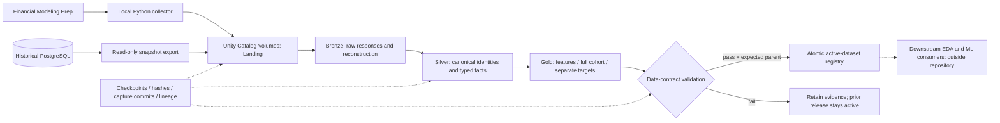

# Architecture

The system separates collection, canonicalization, dataset construction and release authority. A local process is the extraction transport; Unity Catalog and Delta are the authoritative data plane.

## Physical layout

Under an operator-supplied catalog, the project uses `sp500_files`, `sp500_bronze`, `sp500_silver`, `sp500_gold` and `sp500_ops` schemas. The files schema contains `landing`, `checkpoints` and `exports` Volumes. `LakehouseConfig` validates names and constrains paths to the configured Volume.

## Canonical grains

| Asset | Grain / identity |
| --- | --- |
| Security dimension | Reviewed stable security identity; ticker and CIK are attributes, not interchangeable IDs |
| Security routes | Security, effective date and vendor lookup route |
| Membership | Security and actual historical trading day or monthly signal |
| Prices | Security, trading date and adjustment basis; original observations retain capture lineage |
| Financial observations | Security, fiscal period, source row/revision and capture |
| Macro context | Source series and observation date; availability assumptions remain explicit |
| Sector context | Canonical sector / proxy and trading date |
| Gold features | Security and monthly signal, with an ordered predictor allowlist |
| Gold targets | Security and monthly signal, with outcome date and nullable forward returns |

## Release path

1. A uniquely identified capture lands raw wrappers and normalized observations.
2. Verified files are listed explicitly in a committed collector manifest.
3. Databricks appends source evidence and materializes canonical observations.
4. Pure transformation modules construct the current feature families; prior feature months remain pinned to their parent release.
5. Targets preserve known parent returns on their original basis. Unknown outcomes can mature without being replaced by zero.
6. Features, full membership and targets are published as separate immutable tables.
7. Data-contract validation produces a binding-specific receipt.
8. Activation checks table manifests, pinned versions, the expected parent and quarantine status before updating the active pointer.

A source-only clone contains no source records, reviewed live identities or reference dataset. The operator must supply and validate those inputs. Schema DDL alone cannot recreate historical market data or original vendor vintages.

## Boundaries

Databricks holds the source of truth; a verified local consumer export is a cache. The standalone release checks establish data-contract validity, not trained-model parity, backtest quality or investment suitability. Trained models and downstream applications live outside this repository.
